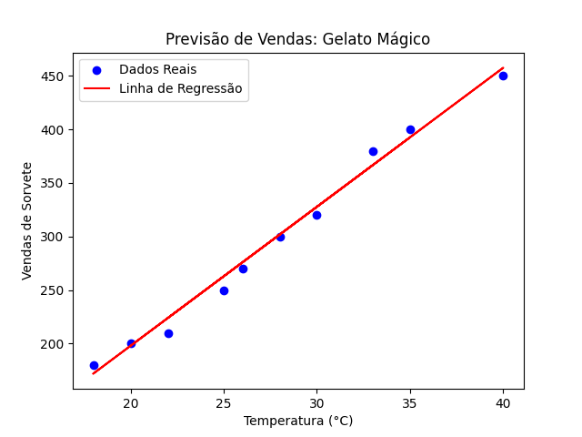

# Gelato Mágico - Previsão de Vendas com Machine Learning

## Descrição do Projeto
Este projeto foi desenvolvido como parte do desafio da **DIO** para criar um modelo de Machine Learning pra de prever as vendas de sorvete com base na temperatura do dia. O objetivo é ajudar a sorveteria **Gelato Mágico** a planejar sua produção e evitar desperdícios.

## Tecnologias Utilizadas
* **Python** (Linguagem principal)
* **Pandas** (Manipulação de dados)
* **Scikit-Learn** (Criação do modelo de Regressão Linear)
* **MLflow** (Gerenciamento do ciclo de vida do modelo)
* **Matplotlib** (Visualização de dados)

## Racional e Metodologia
Utilizei a **Regressão Linear Simples**, pois existe uma correlação linear clara: quanto maior a temperatura ($X$), maior a venda de sorvetes ($y$).

1.  **Coleta de Dados:** Simulei um dataset na pasta `inputs/`.
2.  **Treinamento:** O modelo aprendeu a relação $y = mx + b$.
3.  **Rastreamento:** Utilizei o MLflow para registrar as métricas de erro ($MSE$ e $R^2$).

## Resultados
O modelo apresentou um $R^2$ alto, indicando que a temperatura é um excelente preditor para as vendas.

O Projeto no basico é isso, fiz uma machine learning mais basiquinha porque ainda to aprendendo
---
*Projeto desenvolvido por [Seu Nome] para o Bootcamp de Machine Learning.*